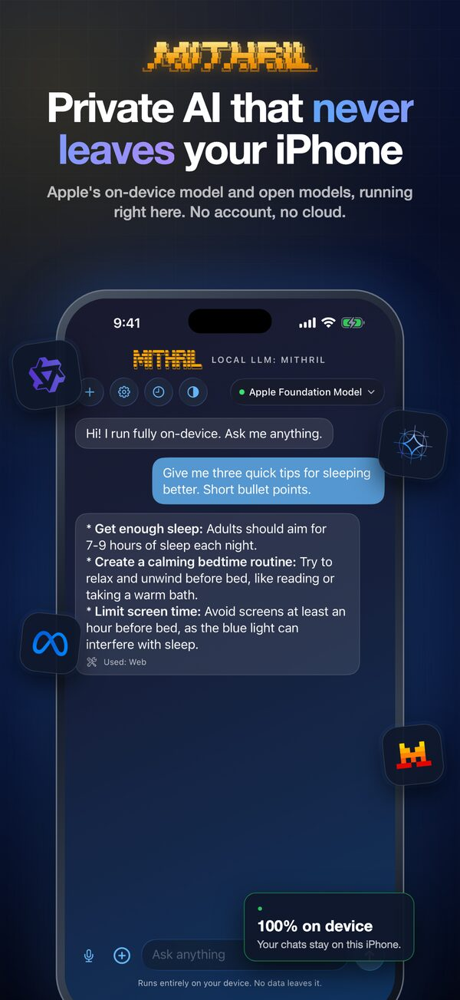

# Josh Berns (bosh)

**I fight the speed of light with software.**

I go after problems where milliseconds decide the outcome and the result lands in the real world: market data that arrives before the trade settles, models that run entirely on the phone in your pocket, game worlds that react inside a single frame. Photographer turned engineer.

[boshjerns.com](https://boshjerns.com) · [mashbox.gg](https://mashbox.gg) · [X](https://x.com/boshjerns) · [LinkedIn](https://www.linkedin.com/in/josh-berns-6a553717b/)

---

## Now building

|  |  |
|:--|:--:|
| **[MASHBOX](https://mashbox.gg)**: any world, any gameplay, any character. MASHBOX puts the worlds and play styles of the games you already own into one engine, with multiplayer. Free early access on Windows, and our own worlds run right in the browser. Research notes from the lab live at [mashbox.gg/labs](https://mashbox.gg/labs). |  |
| **[Return of the Colossi](https://returnofthecolossi.com)**: a browser game homage to Shadow of the Colossus. The first playable build came together in 48 hours, built with AI, three.js, WebGPU, Jolt physics and headless Blender. |  |
| **[Resident Evil 4](https://github.com/boshjerns/re4-boshjerns-sdk)**: decompiled and modded in 12 hours, then running in the browser on WebAssembly and natively on ARM64 with no emulator. |  |

## Apps

|  |  |
|:--|:--:|
| **[Mithril](https://apps.apple.com/us/app/local-llm-mithril/id6751945393)**: private AI that never leaves your phone. Runs language models entirely on iPhone and iPad (Apple's on-device model plus open GGUF models from Hugging Face), with a memory-fit check before every download and a live engine dashboard. It acts with permission through Reminders, Calendar, Messages, Maps and Shortcuts, and transcribes on-device. 4.5★ on the App Store, free. |  |
| **agg.market**: every prediction market venue on one screen, with smart order routing that splits each trade for the best price and live crypto rounds. Native Swift and SwiftUI on iPhone, iPad and Mac from one codebase. Public beta on TestFlight. |  |

## Shipped

- **Polynode, acquired.** Real-time data infrastructure for prediction markets that streams orders to the trading products built on top. agg.market acquired it in July 2026 ([Chainwire](https://www.tradingview.com/news/chainwire:7f0ceb3a3094b:0-agg-market-acquires-polynode-the-fastest-polymarket-data-api/), [Prediction News](https://predictionnews.com/story/agg-market-acquires-polynode-a-polymarket-data-api-provider)).
- **Quantish** let AI agents trade prediction markets and moved about $500K in volume.
- **DoFDGPT** (government contract briefs) and **SnapCycle** (AI recycling assistant), both sold.

## Open source

- **[llama.cpp](https://github.com/ggml-org/llama.cpp/pulls?q=is%3Apr+author%3Aboshjerns)**: regular contributor, mostly reranker, encoder and vision model support.
  - [#29627](https://github.com/ggml-org/llama.cpp/pull/29627) support classifier_pooling for ModernBERT rerankers
  - [#29692](https://github.com/ggml-org/llama.cpp/pull/29692) support classifier_activation for rerankers
  - [#30108](https://github.com/ggml-org/llama.cpp/pull/30108) use exact GELU for ModernBERT encoders
  - [#30736](https://github.com/ggml-org/llama.cpp/pull/30736) match the transformers Qwen-VL resize
- **[MaxDiffusion](https://github.com/AI-Hypercomputer/maxdiffusion/pulls?q=is%3Apr+author%3Aboshjerns)**: correctness fixes for Wan VAE attention and bf16 LoRA merges.
- **[Mithril Whisper](https://github.com/boshjerns/MithrilWhisperApp)**: private on-device dictation for Mac and Windows.
- **[Tmuxius](https://github.com/boshjerns/Tmuxius)**: a compact tmux dashboard for coding agents.

## Before software

I spent years photographing live music on the East Coast as a house photographer for venues including Franklin Music Hall in Philadelphia and I.M.P.'s venues in Washington, D.C., and shot the streets of Baltimore. I learned smart contracts to sell my photography online, built Camera Person (122 photographers from 39 countries in one collection), then trained Stable Diffusion models as a new kind of camera and produced AI video for an AMC documentary.
