# Josh Berns (bosh)

I build real-time software: games and the AI models inside them at MASHBOX, native iPhone, iPad and Mac apps in Swift for agg.market and my own App Store apps, and before that Polynode, the prediction-market data business agg.market acquired in July 2026.

[boshjerns.com](https://boshjerns.com) · [mashbox.gg](https://mashbox.gg) · [X](https://x.com/boshjerns) · [LinkedIn](https://www.linkedin.com/in/josh-berns-6a553717b/)

---

## Now building

|  |  |
|:--|:--:|
| **[MASHBOX](https://mashbox.gg)**: any world, any gameplay, any character. MASHBOX puts the worlds and play styles of the games you already own into one engine, with multiplayer. Free early access on Windows, and our own worlds run right in the browser.  **MASHBOX Labs** trains the models behind our Unreal Engine 5 game, 2034: creature motion that has run live in an in-game playtest, text-to-creature generation where all 36 test creatures import into UE 5.8 rigged and animated, plus the research below. | 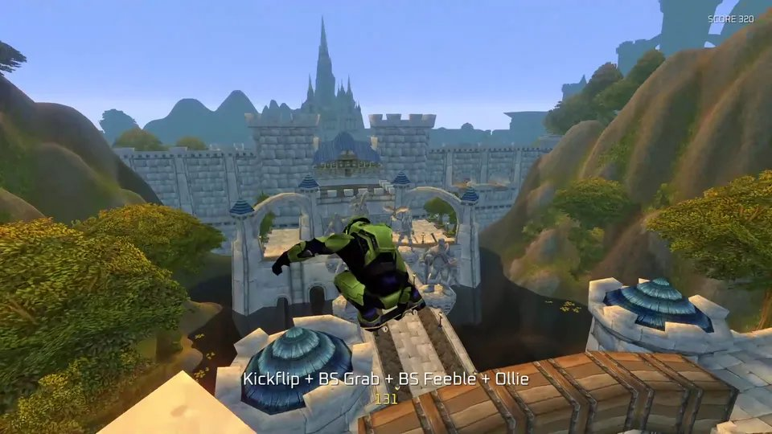 |
| **[Return of the Colossi](https://returnofthecolossi.com)**: a browser game homage to Shadow of the Colossus. The first playable build came together in 48 hours, built with AI, three.js, WebGPU, Jolt physics and headless Blender. | 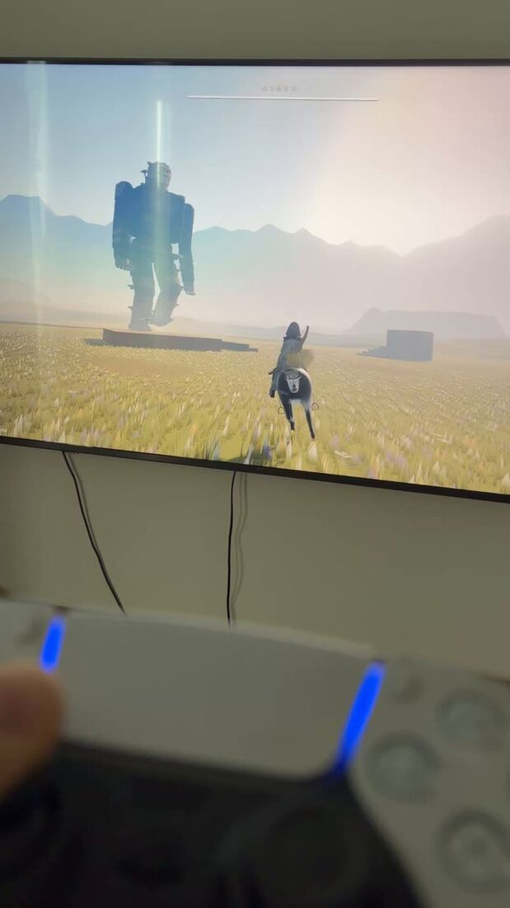 |
| **[Resident Evil 4](https://github.com/boshjerns/re4-boshjerns-sdk)**: decompiled and modded in 12 hours, then running in the browser on WebAssembly and natively on ARM64 with no emulator. | 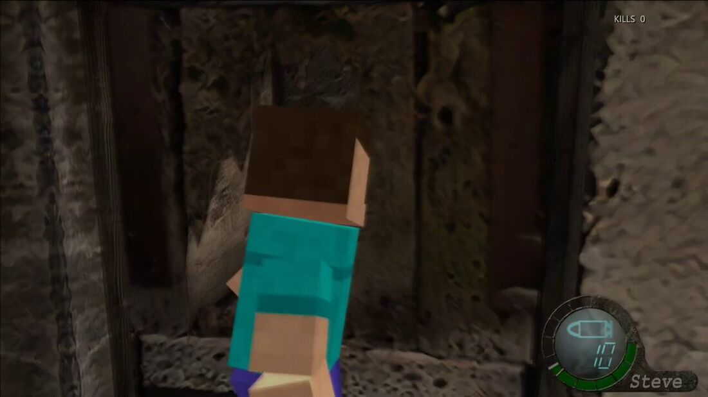 |

## iOS apps (native Swift and SwiftUI)

My App Store apps are published under [Deploy Forward LLC](https://apps.apple.com/us/developer/deploy-forward-llc/id1834702526).

**[Mithril](https://apps.apple.com/us/app/local-llm-mithril/id6751945393)**: private AI that never leaves your phone. Runs language models entirely on iPhone and iPad (Apple's on-device model plus open GGUF models from Hugging Face), with a memory-fit check before every download and a live engine dashboard. It acts with permission through Reminders, Calendar, Messages, Maps and Shortcuts, and transcribes on-device. 4.5★ on the App Store, free.

 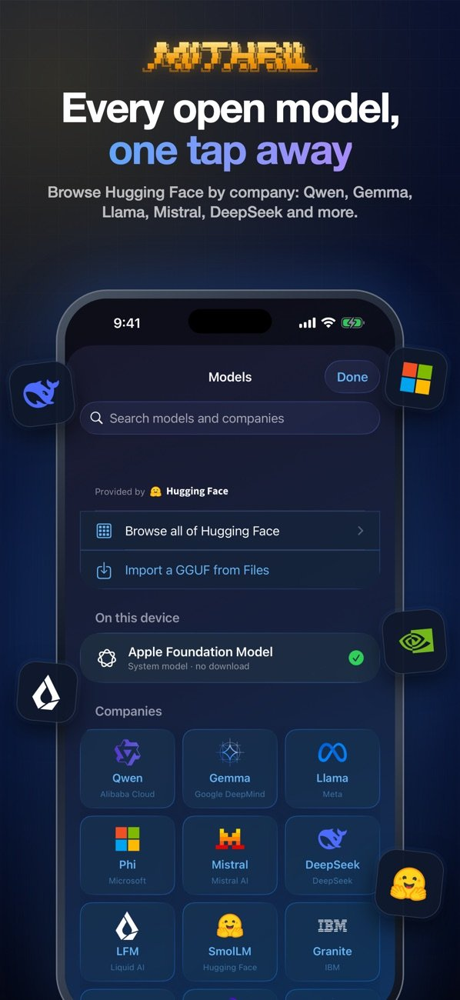 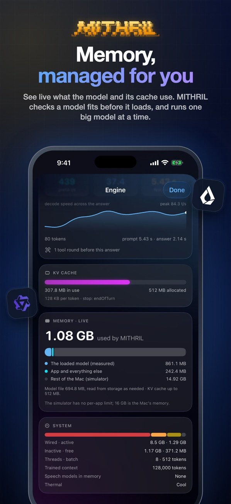

**agg.market**: since the Polynode acquisition I've worked with the agg.market team across the product. The highlight is its native app: every prediction market venue on one screen, smart order routing that splits each trade for the best price, and live crypto rounds, on iPhone, iPad and Mac from one codebase. Public beta on TestFlight.

  

**[infipedia](https://apps.apple.com/us/app/infipedia/id6752109334)**: an infinite wiki that writes itself as you click, running a local language model entirely on the phone, even in airplane mode. 5★.

**[FPV Drone Operator Manual](https://apps.apple.com/us/app/fpv-drone-operator-manual/id6752651844)**: a field manual for building FPV drones, with components, compatibilities, connections and example builds. 5★.

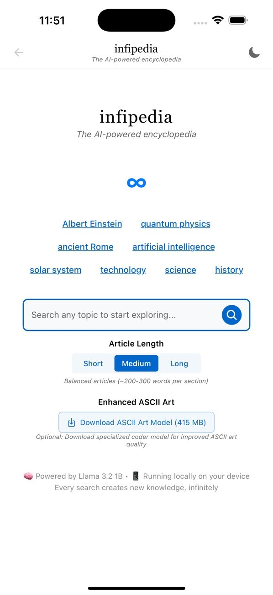 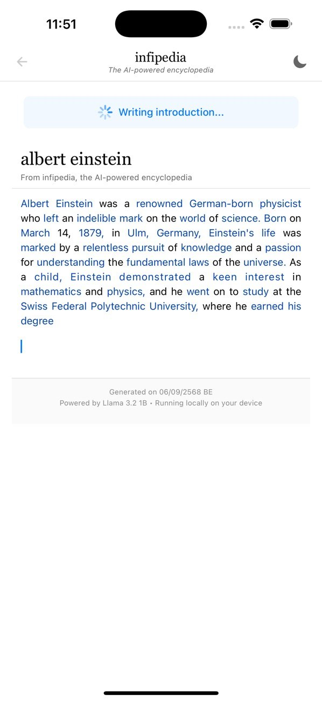 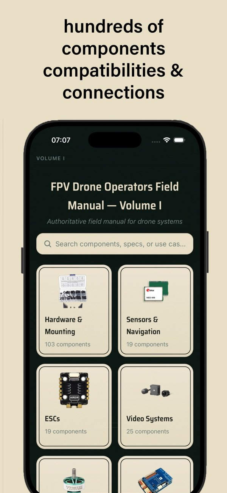 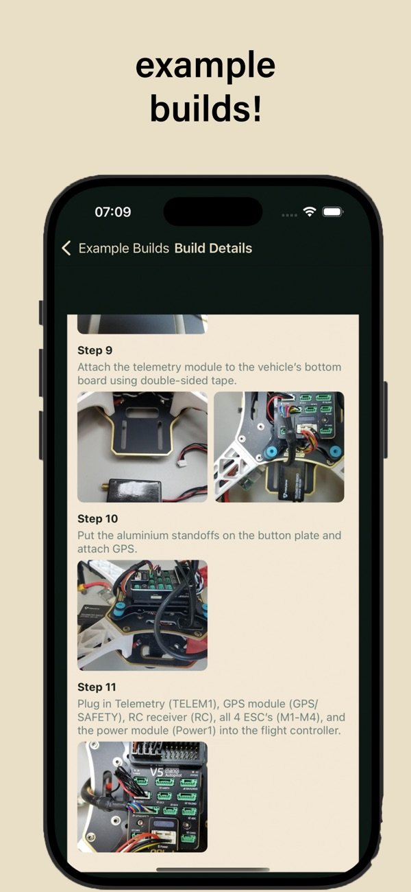

## Shipped

- **Polynode, acquired.** I built and ran Polynode, low-latency trading infrastructure for prediction markets: real-time market and order data streamed to the trading products built on top, with paying API customers. Its data has powered about $2 billion of trading volume to date, and it's still running. agg.market acquired it in July 2026 ([Chainwire](https://www.tradingview.com/news/chainwire:7f0ceb3a3094b:0-agg-market-acquires-polynode-the-fastest-polymarket-data-api/), [Prediction News](https://predictionnews.com/story/agg-market-acquires-polynode-a-polymarket-data-api-provider)).
- **Quantish** let AI agents trade prediction markets and moved about $500K in volume.
- **DoFDGPT** (government contract briefs) and **SnapCycle** (AI recycling assistant), both sold.

## Models and research

At **[MASHBOX Labs](https://mashbox.gg/labs)** I work on the models a living game world needs, and publish measured results with the benchmark and hardware next to each number. Current directions:

- **Creature motion for any skeleton**: one model that animates bodies it has never seen on our own synthetic benchmark, from quadrupeds to creatures with extra limbs.
- **Text to game-ready creatures**: a prompt in, a rigged, skinned and animated character out that imports straight into Unreal Engine.
- **Character motion from text**: fast human motion generation for in-game characters.
- **Full-duplex voice**: characters that listen and talk at the same time, with natural turn-taking.
- **Game worlds as simulators**: physics, people and labels the engine measures exactly, as training data, working toward models that work in the real world.
- **Fast inference**: real-time models on consumer GPUs and phones, and training on Cloud TPUs.

Along the way I fix correctness bugs in the open-source runtimes we build on: [llama.cpp](https://github.com/ggml-org/llama.cpp/pulls?q=is%3Apr+author%3Aboshjerns) (reranker, encoder and vision models) and Google's [MaxDiffusion](https://github.com/AI-Hypercomputer/maxdiffusion/pulls?q=is%3Apr+author%3Aboshjerns) (Wan VAE attention, bf16 LoRA merges).

## Open source

- **[Mithril Whisper](https://github.com/boshjerns/MithrilWhisperApp)**: private on-device dictation for Mac and Windows.
- **[Tmuxius](https://github.com/boshjerns/Tmuxius)**: a compact tmux dashboard for coding agents.

## Experiments

Smaller things I built and posted on [X](https://x.com/boshjerns).

|  |  |
|:--|:--:|
| Resident Evil 4 played as enemy characters, running in the browser on WebAssembly and natively on ARM64 with no emulators. [Post](https://x.com/boshjerns/status/2106994405232312748) | 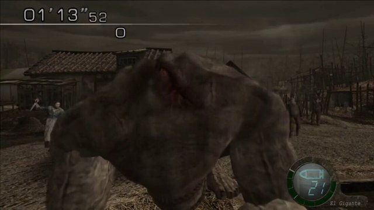 |
| Turned my MRI scan from a CD into a 3D model of my cerebral veins with a few scripts. [Post](https://x.com/boshjerns/status/1929395825706156299) | 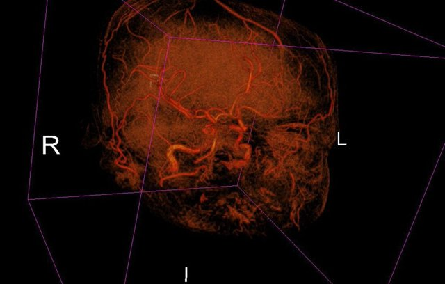 |
| Built a browser agent that applied to a software engineering job for me. [Post](https://x.com/boshjerns/status/1926093250223358126) | 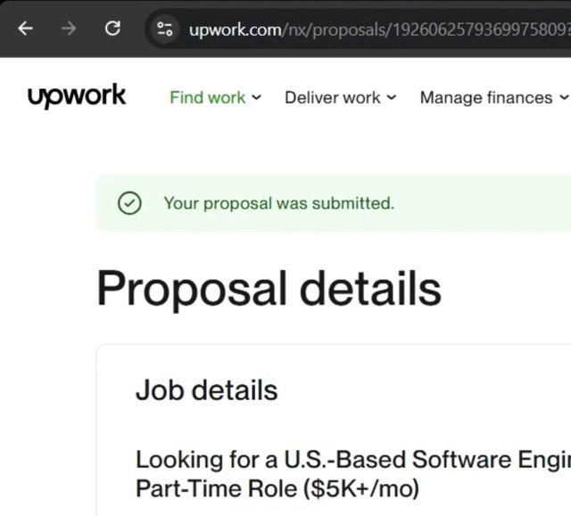 |
| Stable Diffusion animation for a TV docu-series: generate with a specific model, then add motion. [Post](https://x.com/boshjerns/status/1758247341168152827) |  |
| None of these portraits are real photographs. Each comes from a Stable Diffusion model trained on my photos of that person. [Post](https://x.com/boshjerns/status/1708237946313159045) | 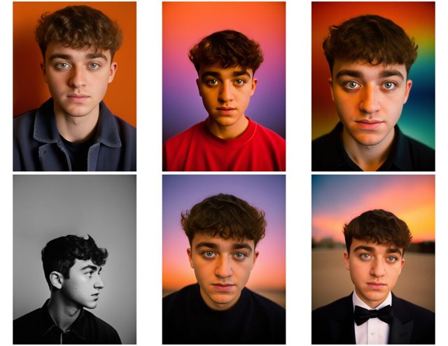 |

## Before software

I spent years photographing live music on the East Coast as a house photographer for venues including Franklin Music Hall in Philadelphia and I.M.P.'s venues in Washington, D.C., and shot the streets of Baltimore. I learned smart contracts to sell my photography online, built Camera Person (122 photographers from 39 countries in one collection), then trained Stable Diffusion models as a new kind of camera and produced AI video for an AMC documentary.
